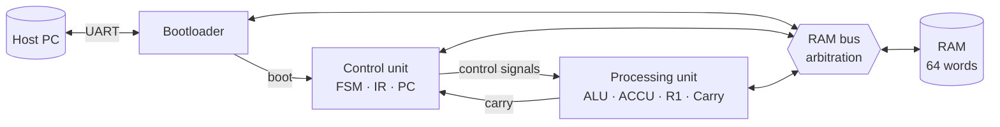

# Mini-CPU: an 8-bit accumulator processor in VHDL

A small general-purpose processor designed from scratch in VHDL and targeted at
a Xilinx **Artix-7 FPGA**. It has a 4-instruction accumulator ISA, a multi-cycle
FSM controller, on-chip RAM, and a **UART bootloader** that loads programs from
a PC and reads the results back.

> 2nd-year engineering project, **ENSEIRB-MATMECA** (Bordeaux INP),
> *Embedded Systems & Computer Engineering* specialization.


---

## At a glance

| | |
|---|---|
| **Architecture** | Accumulator machine, von Neumann (shared program/data memory) |
| **Instruction**  | 8 bits: 2-bit opcode + 6-bit address |
| **ISA**          | `NOR`, `ADD`, `STA` (store), `JCC` (jump if carry clear) |
| **Memory**       | 64-word synchronous single-port RAM |
| **Control**      | 10-state Moore FSM, 4–6 cycles per instruction |
| **I/O**          | UART 115 200 bit/s: program upload + memory dump |
| **Target**       | `xc7a100tcsg324-1` @ 100 MHz |

*Original course specification (FR):* « Le processeur à concevoir est un
processeur 8 bits à usage universel. Il est capable d'exécuter 4 types
d'instructions. Ce processeur est basé sur un registre accumulateur appelé ACCU
de taille 8 bits. Chaque instruction est codée sur 8 bits : deux bits pour coder
le type de l'opération (code op) et 6 bits pour coder l'opérande ou l'adresse de
l'opérande dans la mémoire selon le type de l'instruction. »

## Block diagram



## Instruction set

| Opcode | Mnemonic  | Operation                                  |
|:------:|-----------|--------------------------------------------|
| `00`   | `NOR adr` | `ACCU ← ACCU NOR MEM[adr]`                 |
| `01`   | `ADD adr` | `ACCU ← ACCU + MEM[adr]`, updates carry    |
| `10`   | `STA adr` | `MEM[adr] ← ACCU`                          |
| `11`   | `JCC adr` | `if C = 0: PC ← adr`, else clear `C`       |

`NOR` is functionally complete, so these four instructions are enough to write
real programs: see the two's complement and GCD examples in
[`programs/`](programs).

## Repository layout

```
.
├── rtl/                     Synthesisable VHDL
│   ├── top/                 CPU_Bootloader: top level, RAM bus arbitration
│   ├── control_unit/        Control_Unit, FSM_processor, Counter_Prog (PC), mux2_6
│   ├── processing_unit/     Processing_unit, UAL (ALU), Registre_16bits, Registre_1bit
│   ├── memory/              RAM_SP_64_8: synchronous single-port RAM
│   ├── common/              Generic building blocks (mux2_1)
│   └── bootloader/          UART bootloader (provided by the course)
├── sim/tb/                  Unit testbenches (FSM, control unit)
├── programs/                Test programs (memory images) + disassembly
├── constraints/             Board .xdc goes here
├── scripts/                 create_vivado_project.tcl
├── docs/
│   ├── architecture.md      Detailed design & architectural choices
│   └── instruction_set.md   ISA reference and programming idioms
└── Makefile                 GHDL analysis/elaboration check
```

## Getting started

### Quick check with GHDL (open source)

```bash
make check     # analyses every RTL file and elaborates CPU_Bootloader
make clean
```

### Vivado

```bash
vivado -mode batch -source scripts/create_vivado_project.tcl
# then open build/vivado/mini_cpu.xpr
```

The script regenerates the project from the sources, so no tool-generated files
are versioned. Add your board's `.xdc` to [`constraints/`](constraints) to run
implementation and generate a bitstream.

### Running a program on the board

1. Program the FPGA and press **reset**: the bootloader waits for data.
2. Send a 64-word memory image from [`programs/`](programs) over the UART
   (115 200 bit/s, 2 bytes per word, low byte first).
3. After the 64th word the CPU starts executing automatically.
4. Press **scan_memory**: the bootloader sends the 64 RAM words back to the PC.

## Documentation

* **[Architecture & design choices](docs/architecture.md)**: datapath,
  control unit, FSM state diagram and output table, memory, bootloader
  protocol, and the reasoning behind each choice.
* **[Instruction set](docs/instruction_set.md)**: encoding, timing, and how to
  build other operations from `NOR`/`ADD`/`JCC`.
* **[Test programs](programs/README.md)**: annotated disassembly and expected
  results.

## Project status

The individual blocks (registers, ALU, control FSM, control unit, RAM) are
implemented and were unit-simulated, and the full design elaborates without
errors. End-to-end program execution is **not yet functional**: the program
counter increment path and the fetch address selection still need work. The
root causes and the planned fixes are listed in
[docs/architecture.md § Status](docs/architecture.md#status-and-known-limitations).

## What I worked on / skills shown

* RTL design in VHDL: registers, ALU, counters, multiplexers, inferred RAM
* Finite-state-machine design (3-process Moore style) for instruction sequencing
* Datapath / controller partitioning and hierarchical, structural integration
* Integration with a UART-based bootloader and shared-bus arbitration
* Simulation and debugging with Vivado XSim / GHDL
* Xilinx Vivado flow targeting an Artix-7 FPGA

## Credits

* **Design & implementation:** Marcel Szerszen in collaboration with Nicolas Caspar, ENSEIRB-MATMECA
* **Course material:** the UART cores (`uart_recv.vhd`,
  `UART_fifoed_send_V1.vhd`, written by Y. Bornat), the bootloader
  (`boot_loader.vhd`, `byte_2_word.vhd`, `word_2_byte.vhd`), the top-level
  template (`CPU_Bootloader.vhd`) and the test programs were provided by the
  ENSEIRB-MATMECA teaching staff as part of the lab kit.
