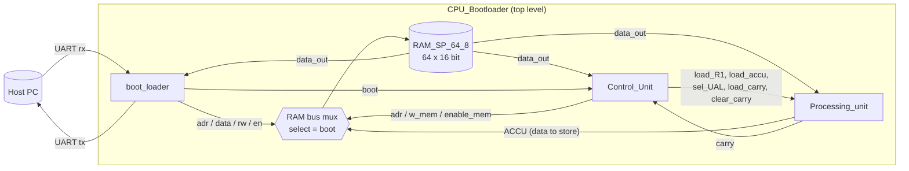
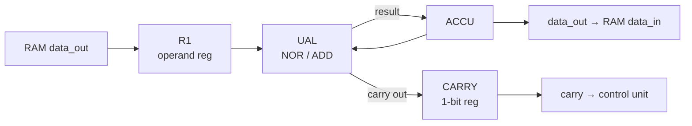
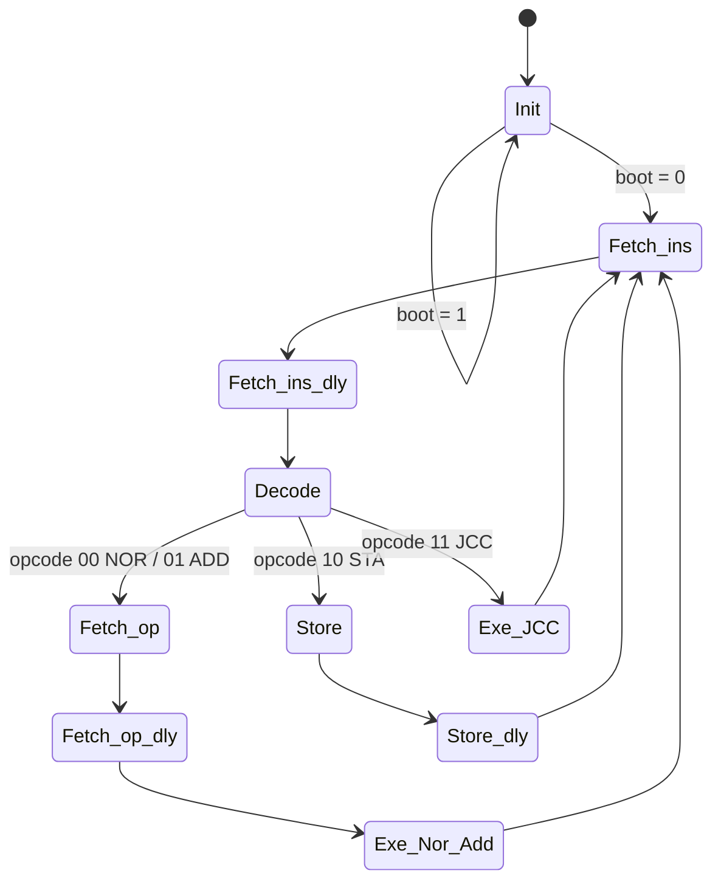

# Architecture

This document describes how the Mini-CPU is built, module by module, and why
it was built that way.

- [1. Overview](#1-overview)
- [2. Top level and boot sequence](#2-top-level-and-boot-sequence)
- [3. Processing unit (datapath)](#3-processing-unit-datapath)
- [4. Control unit](#4-control-unit)
- [5. Control FSM](#control-fsm)
- [6. Memory](#memory)
- [7. Bootloader and UART link](#7-bootloader-and-uart-link)
- [8. Design choices](#8-design-choices)
- [9. Status and known limitations](#status-and-known-limitations)

---

## 1. Overview

The design follows the classic **datapath + controller** split:

* the **processing unit** (*unité de traitement*, UT) stores and transforms data,
* the **control unit** (*unité de commande*, UC) sequences instructions and
  drives the datapath with control signals,
* a **single-port RAM** holds both program and data (von Neumann architecture),
* a **UART bootloader** loads a program into RAM from a PC, starts the CPU, and
  can later send the RAM contents back for inspection.



### Module hierarchy

```
CPU_Bootloader                      rtl/top/
├── Control_Unit       (UC)         rtl/control_unit/
│   ├── FSM_processor               control sequencer
│   ├── Registre_16bits  (RI)       instruction register
│   ├── Counter_prog     (PC)       program counter
│   └── mux2_6                      address source select (IR field / PC)
├── Processing_unit    (UT)         rtl/processing_unit/
│   ├── UAL                         ALU: NOR / ADD
│   ├── Registre_16bits  (R1)       operand register
│   ├── Registre_16bits  (ACCU)     accumulator
│   └── Registre_1bit    (CARRY)    carry flag
├── RAM_SP_64_8        (UM)         rtl/memory/
└── boot_loader        (BL)         rtl/bootloader/
    ├── UART_recv
    ├── UART_fifoed_send
    ├── byte_2_word
    └── word_2_byte
```

Naming follows the French course conventions: *UAL* (*unité arithmétique et
logique*) = ALU, *Registre* = register, *RI* = instruction register,
*UC/UT/UM* = control / processing / memory unit.

---

## 2. Top level and boot sequence

`CPU_Bootloader` instantiates the four blocks and arbitrates the single RAM
port with a 2:1 multiplexer on every RAM input (`adr`, `data_in`, `r_w`,
`enable`), selected by the bootloader's `boot` output:

| `boot` | RAM is driven by | CPU state                              |
|:------:|------------------|----------------------------------------|
| `1`    | bootloader       | FSM held in `Init` (PC and carry cleared) |
| `0`    | control unit + ACCU | CPU fetches and executes             |

Operating sequence:

1. **Reset** → bootloader in `INIT`, `boot = 1`, CPU frozen.
2. **Load** → 64 × 16-bit words arrive over UART and are written to addresses
   0…63.
3. **Run** → after the 64th word the bootloader releases the bus (`boot = 0`)
   and the CPU starts executing from address 0.
4. **Scan** → pressing `scan_memory` makes the bootloader take the bus back and
   stream the 64 RAM words to the PC, so results can be checked from the host.

Top-level ports: `clk` (100 MHz), `rst` (active high, asynchronous),
`ce` (clock enable for the CPU registers), `scan_memory`, `rx`, `tx`.

---

## 3. Processing unit (datapath)



| Block       | File                 | Role |
|-------------|----------------------|------|
| `R1`        | `Registre_16bits.vhd` | Latches the operand read from memory (`load_R1`). Decouples the RAM output from the ALU so that the memory bus is free during execution. |
| `UAL`       | `UAL.vhd`            | `sel_UAL = 0` → `R1 NOR ACCU`; `sel_UAL = 1` → `R1 + ACCU`, with the 17th bit of the sum as carry. Updates only when `load_accu = 1`. |
| `ACCU`      | `Registre_16bits.vhd` | Accumulator. Its output is also the data written to memory by `STA`. |
| `CARRY`     | `Registre_1bit.vhd`  | Carry flag with a **synchronous `clear`** that has priority over `load`, so `JCC` and `Init` can reset it without touching the datapath. |

All registers share the same template: asynchronous reset, rising-edge clock,
gated by both `ce` (global clock enable) and a dedicated `load` signal.

---

## 4. Control unit

The control unit is structural: it wires the FSM to three datapath elements.

| Block      | File                 | Role |
|------------|----------------------|------|
| `RI`       | `Registre_16bits.vhd` | Instruction register, loaded from RAM during fetch (`load_RI`). `RI(7:6)` feeds the FSM as the opcode, `RI(5:0)` is the operand address / jump target. |
| `PC`       | `Counter_Prog.vhd`   | Program counter; can be loaded with `RI(5:0)` (jump). |
| `mux2_6`   | `mux2_6.vhd`         | Chooses the RAM address: the instruction's address field or the PC (`sel_adr`). |
| `FSM`      | `FSM_processor.vhd`  | Generates all control signals (below). |

Reusing the generic 16-bit register for `RI` keeps the number of distinct
building blocks small: the same verified register is instantiated three times
(`RI`, `R1`, `ACCU`).

<a id="control-fsm"></a>

## 5. Control FSM

The FSM is a **Moore machine written in the three-process style**: one
clocked process for the state register, one combinational process for the
next-state logic, and one combinational process for the outputs. Every output
is assigned in every state, which prevents latch inference.



### Output table

| State           | `sel_adr` | `enable_mem` | `w_mem` | `load_RI` | `load_R1` | `load_accu` | `sel_UAL` | `load_carry` | `clear_carry` | `enable_pc` | `load_pc` |
|-----------------|:-:|:-:|:-:|:-:|:-:|:-:|:-:|:-:|:-:|:-:|:-:|
| `Init`          | 0 | 0 | 0 | 0 | 0 | 0 | 0 | 0 | **1** | 0 | 0 |
| `Fetch_ins`     | 0 | **1** | 0 | 0 | 0 | 0 | 0 | 0 | 0 | 0 | 0 |
| `Fetch_ins_dly` | 0 | **1** | 0 | **1** | 0 | 0 | 0 | 0 | 0 | 0 | 0 |
| `Decode`        | 1 | 0 | 0 | 0 | 0 | 0 | 0 | 0 | 0 | 0 | 0 |
| `Fetch_op`      | 1 | **1** | 0 | 0 | **1** | 0 | 0 | 0 | 0 | 0 | 0 |
| `Fetch_op_dly`  | 1 | **1** | 0 | 0 | **1** | 0 | 0 | 0 | 0 | 0 | 0 |
| `Exe_Nor_Add`   | 1 | 0 | 0 | 0 | 0 | **1** | op(0) | op(0) | 0 | **1** | 0 |
| `Exe_JCC`       | 1 | 0 | 0 | **1** | 0 | 0 | 0 | 0 | C | C | not C |
| `Store`         | 1 | **1** | **1** | 0 | 0 | 0 | 0 | 0 | 0 | 0 | 0 |
| `Store_dly`     | 1 | **1** | 0 | 0 | 0 | 0 | 0 | 0 | 0 | **1** | 0 |

`op(0)` is the low opcode bit, so one execute state serves both `NOR` (`00`)
and `ADD` (`01`): the bit directly selects the ALU operation and enables the
carry update only for `ADD`.

---

<a id="memory"></a>

## 6. Memory

`RAM_SP_64_8` is a **synchronous single-port RAM**, 64 words deep, with
generic word width (`NbBits`, 16 in this design) and address width (`Nbadr`,
6). Write and read are both on the rising edge; when `r_w = 1` the word is
written, otherwise `data_out` is updated with `MEM[add]` one cycle later.

It is written as an inferred array with a clocked read, the pattern Vivado
maps onto distributed/block RAM without needing a vendor IP core. The
one-cycle read latency is why the FSM has a `*_dly` state after each memory
access.

The word width is 16 bits, not 8, to stay compatible with the course's
bootloader and PC tools, which exchange 16-bit words (2 UART bytes per
address).

---

## 7. Bootloader and UART link

> These modules were provided by the teaching staff (UART cores written by
> Y. Bornat, ENSEIRB-MATMECA) and are reused as-is. They are documented here
> because they define how the CPU talks to the outside world.

| Parameter        | Value                                        |
|------------------|----------------------------------------------|
| Clock            | 100 MHz                                      |
| Baud rate        | 115 200 bit/s                                |
| Word transfer    | 2 bytes per 16-bit word, **low byte first**  |
| Program size     | 64 words = 128 bytes                         |
| Dump pacing      | one word every ~18 000 cycles (~180 µs) to stay below the UART throughput |

* `UART_recv` deserialises bytes; `byte_2_word` pairs them into 16-bit words.
* `word_2_byte` splits RAM words back into bytes; `UART_fifoed_send` serialises
  them through a small FIFO.
* `boot_loader` is itself a 10-state FSM
  (`INIT → WAIT_RX_BYTE ⇄ WRITE_RX_BYTE/INCR → WAIT_SCAN_MEM → READ_TX_BYTE →
  ENABLE_TX → INCR_TX → WAIT_8K_CYCLE → … → OVER`) that owns the RAM bus
  whenever it asserts `boot`.

---

## 8. Design choices

| Choice | Rationale |
|--------|-----------|
| **Accumulator ISA, 4 instructions** | Smallest instruction set that is still Turing-complete (`NOR` is functionally complete, `ADD` gives arithmetic, `JCC` gives control flow). Keeps the FSM and decoder tiny. |
| **Datapath / controller separation** | Each half can be designed and unit-tested on its own (`tb_FSM.vhd`, `tb_control_unit.vhd`), then integrated at the top level. |
| **Multi-cycle execution** | A single shared RAM port is used for instruction fetch, operand fetch and store, so instructions naturally take several cycles. No pipeline hazards to deal with. |
| **Moore FSM, 3-process style** | Outputs depend only on the current state (plus `opcode`/`carry` in two execute states). Glitch-free and easy to read as a table. All outputs assigned in all states → no latches. |
| **Explicit `_dly` states for memory** | Matches the synchronous RAM's 1-cycle read latency instead of relying on asynchronous reads, which FPGAs implement poorly. |
| **Shared `opcode(0)` for NOR/ADD** | One execute state for both ALU instructions; the opcode bit directly drives `sel_UAL` and `load_carry`. |
| **Generic reusable registers** | One 16-bit register entity is used for `RI`, `R1` and `ACCU`; registers have `ce` + `load` enables so the whole CPU can be single-stepped/paused from a switch. |
| **Carry clear with priority** | Lets `JCC` consume the flag in the same cycle it tests it, which gives the "fall-through clears C" semantics the programs rely on. |
| **Generic widths** (`RAM_ADR_WIDTH`, `NbBits`) | Memory and address width are parameters at the top level, so the memory map could grow without rewriting modules. |
| **Bus mux at the top level** | The bootloader and the CPU never need to know about each other: a single `boot` signal hands the RAM over. |

---

<a id="status-and-known-limitations"></a>

## 9. Status and known limitations

The project was developed during timed lab sessions. All modules analyse and
the top level elaborates cleanly (`make check` with GHDL, and in the Vivado
2022 simulator). The individual blocks (FSM, control unit) were checked in simulation.
Reviewing the RTL and running the full CPU in simulation with `pgcd.txt`
preloaded shows that the integration is **not yet complete**: the program
does not run to completion. Root causes found:

1. **Program counter never increments.** `Counter_prog` only loads `data_in`
   when both `enable` and `load` are `1`; there is no `PC + 1` path, and the
   FSM never asserts both signals at once (in `Exe_JCC`,
   `enable_pc = C` and `load_pc = not C`).
2. **Address mux polarity.** `mux2_6` outputs the PC when `sel_adr = 1`, but
   the FSM uses `sel_adr = 0` for instruction fetch and `1` for operand
   access: the opposite of what the instruction sequence needs.
3. **Opcode field position.** The control unit decodes `RI(7:6)`, whereas the
   sample programs encode the opcode in bits `15:14`.
4. **ALU latency.** In `UAL`, the sum is computed into a signal and copied to
   `Result` on the same clock edge, so `ADD` returns the previous sum. A
   variable or a combinational adder would fix it.
5. **Minor points.** `clear_PC` is generated but not connected, the RAM
   ignores its `enable` input, the FSM state register does not use `ce`, and
   the two unit testbenches in `sim/tb/` still use an older port list
   (`sel_UAL` as 3 bits, `enable`/`WR` outputs) and need updating before they
   elaborate again. The system testbench (`tb_CPU_Bootloader`) and its file
   I/O helpers came from the course kit and are not included.

### Next steps

* Add an increment path to `Counter_prog` (`PC ← PC + 1` when
  `enable = 1, load = 0`) and invert the `mux2_6` select.
* Align the opcode field with the program encoding.
* Make the ALU result combinational (or use a variable) so ACCU loads the
  current sum.
* Update the unit testbenches and add a self-checking system testbench that
  loads `programs/*.txt` and asserts the expected results.
